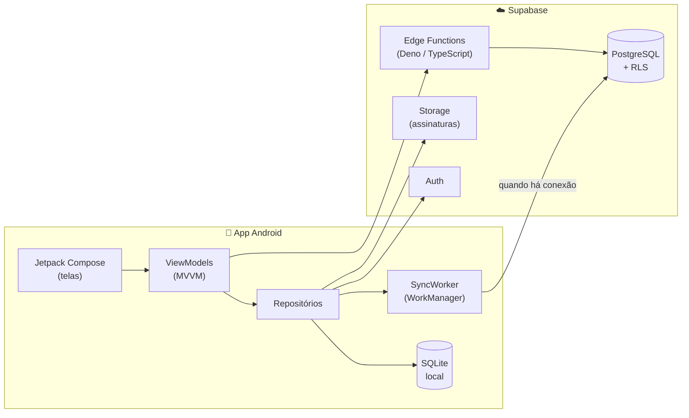

# Recadastre.IA

**Recadastramento de clientes em campo para empresas de saneamento, mesmo sem internet.**

---

## Sobre o projeto

Em empresas de saneamento, o cadastro de clientes costuma ficar desatualizado: nome do titular, endereço,
número de economias, tipo de imóvel. Corrigir isso exige equipes em campo, muitas vezes em áreas **sem sinal
de celular**, preenchendo papel que depois precisa ser digitado de novo.

O **Recadastre.IA** resolve isso de ponta a ponta. O agente de campo registra os dados do imóvel e do
responsável direto no celular, com GPS, consulta de CEP e assinatura digital. Tudo fica salvo no aparelho e
**sincroniza sozinho** com o servidor quando a conexão volta. A gestão acompanha a produção por cidade, em
tempo real.

Projeto criado e desenvolvido por mim, do zero, a partir de um problema real que eu via no dia a dia da
operação.

## Funcionalidades

| | |
| --- | --- |
| 📋 **Recadastro completo** | Dados do imóvel e do responsável, validação de campos, máscaras, GPS e endereço por CEP (ViaCEP) |
| 📶 **Offline-first** | Banco SQLite local + fila de sincronização com `WorkManager`; nada se perde sem sinal |
| ✅ **Índice de qualidade** | Cada cadastro recebe uma nota de 0 a 100, com pesos maiores para os campos críticos |
| ✍️ **Assinatura digital** | Captura da assinatura com hash SHA-256 da imagem, para auditoria |
| 🏢 **Grandes empreendimentos** | Fluxo próprio para prédios e condomínios com várias economias |
| 🏆 **Meu Desempenho** | Gamificação para a equipe: XP, níveis, sequência de dias, conquistas e meta diária por cidade |
| 🗺️ **Multi-cidade** | Cada usuário só enxerga as cidades autorizadas, com o controle feito no próprio banco (RLS) |
| 👥 **Perfis de acesso** | Equipe de campo, administrador e desenvolvedor, cada um com suas telas |
| 🔄 **Atualização automática** | O app verifica novas versões e se atualiza sozinho |

## Arquitetura

## Stack

| Camada | Tecnologias |
| --- | --- |
| **App** | Kotlin, Jetpack Compose, Material 3, arquitetura MVVM, Navigation Compose |
| **Dados locais** | SQLite, WorkManager, AndroidX Security (armazenamento criptografado) |
| **Rede** | Ktor, Retrofit, OkHttp, kotlinx.serialization |
| **Backend** | Supabase: PostgreSQL, Row Level Security, Auth, Storage, Realtime |
| **Serverless** | Edge Functions em TypeScript (Deno) para criação de usuários multi-cidade |
| **Serviços** | Google Play Services Location, ViaCEP |
| **CI/CD** | GitHub Actions: build a cada PR e publicação de versões por tag |

## Destaques técnicos

- **Sincronização offline robusta**: os registros ficam numa fila local e são enviados em segundo plano.
  O `updated_at` é carimbado pelo servidor (trigger no Postgres), o que mantém o *delta sync* confiável
  mesmo quando um cadastro feito offline só é enviado horas depois.
- **Segurança no banco, não só no app**: políticas RLS e funções `security definer` garantem que cada
  usuário acesse apenas as cidades vinculadas a ele (tabela de junção `usuario_cidades`).
- **Migrações versionadas** com uma regra fixa: mudanças de schema nunca apagam dados de clientes.
- **Qualidade de dados**: limpeza de inconsistências (`NULL` vs. texto vazio, duplicidades de matrícula)
  e normalização feita por migração, de forma rastreável.
- **Pipeline de release**: uma tag `vX.Y.Z` gera o APK pelo GitHub Actions e publica neste repositório,
  de onde o app busca as atualizações.

## Números

- ~12 mil linhas de Kotlin
- 10+ telas (recadastro, grandes empreendimentos, desempenho, painel admin, gestão de usuários...)
- Backend com migrações versionadas, Edge Functions e políticas RLS por cidade

## Sobre este repositório

Este é o repositório **público** do projeto. Ele serve como vitrine e como canal de distribuição das versões
(APKs) que o próprio aplicativo consulta para se atualizar.

O **código-fonte é privado** e proprietário. Posso apresentá-lo em uma avaliação técnica ou entrevista,
é só entrar em contato.

## Autor

**Matheus Marques**: graduando em Análise e Desenvolvimento de Sistemas, interessado em desenvolvimento
mobile, back-end e automação de processos.

---

© 2026 Matheus Marques. Todos os direitos reservados.
